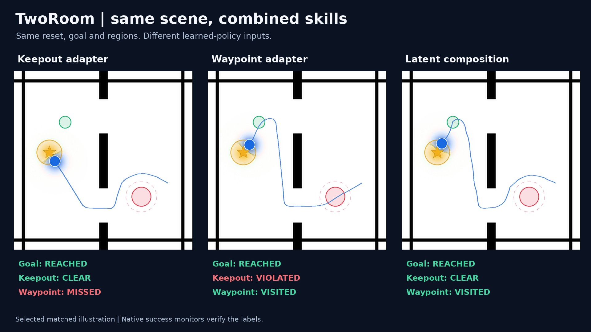
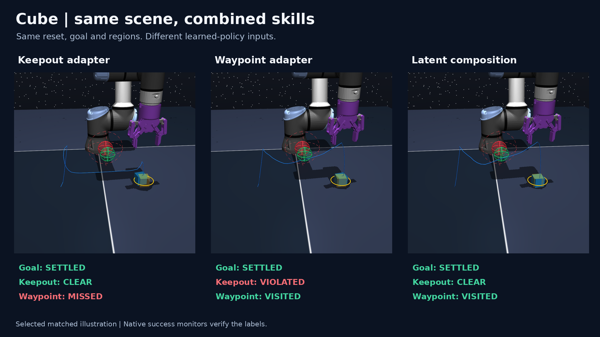
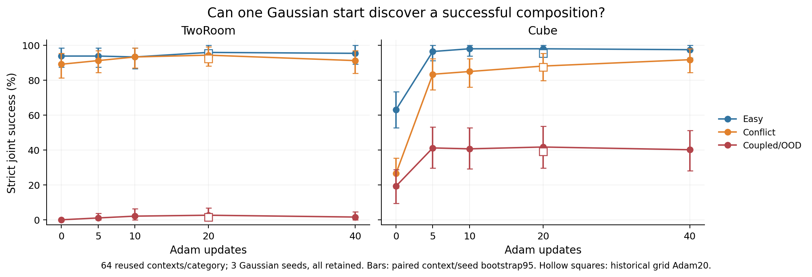

# GanExpansion

**Generative policies, independent skill adapters, and latent skill composition.**

GanExpansion studies generative policies and independent skill addition in two environments: continuous **TwoRoom navigation** and native **OGBench single-cube manipulation**. The base predicts action chunks; separately trained keepout and waypoint adapters add new constraints. Composition uses those same frozen action models and optimizes their inputs. This guide includes the original base/individual-skill results, subsequent training studies, the original composition reference, and the latest single-Gaussian initialization experiment.

The repository contains source, tests, configurations, and this guide. Original pretrained models and benchmark inputs remain in [v1.0.0](https://github.com/hakanmuluk/GanExpansion/releases/tag/v1.0.0). The [v1.1.0 release](https://github.com/hakanmuluk/GanExpansion/releases/tag/v1.1.0) adds current composition weights, the completed base/adapter study models, aggregate evidence, and editable reports. Downloads are checksum verified and install into separate paths.

## Presentation videos and images

The [presentation media release](https://github.com/hakanmuluk/GanExpansion/releases/tag/v1.2.0) contains **36 silent 1080p videos and 114 images**, with an offline gallery: base policies, each independent adapter, conflict/OOD composition, and six matched comparisons. Start with the [overview video](https://github.com/hakanmuluk/GanExpansion/releases/download/v1.2.0/overview.mp4), then the [Cube comparison](https://github.com/hakanmuluk/GanExpansion/releases/download/v1.2.0/cube-matched-comparison.mp4) or [TwoRoom comparison](https://github.com/hakanmuluk/GanExpansion/releases/download/v1.2.0/tworoom-matched-comparison.mp4).

| TwoRoom: same scene, three policies | Cube: same reset, three policies |
|---|---|
|  |  |

Blue is the agent/carried cube, gold the goal, red keepout, and green the waypoint. A matched story shows keepout alone missing the waypoint, waypoint alone violating keepout, and composition meeting both constraints. Markers only decorate the native renderer; the frozen models and physics are unchanged. Cube keepout concerns the transported cube, not the whole arm.

These are **curated illustrations of the latest single-Gaussian experiment below**, not a new experiment or success-rate estimate. The clips use 20 Adam updates in TwoRoom and 40 in Cube. Aggregate coupled/OOD success at those budgets is only **2.6% / 40.1%**; the selected successes do not imply general OOD reliability. Planning-compute delays are omitted from playback.

Download directly to a drive with enough space, then open `index.html` in the destination. No GPU is needed to watch. Archive and individual-file checksums are verified by the existing downloader.

~~~bash
python scripts/download_assets.py --manifest configs/presentation_assets.json \
  --bundle presentation --root "/path/on/external-drive/GanExpansion-media"
~~~

[Media guide and rendering instructions](docs/PRESENTATION_MEDIA.txt) · [Native rendering source](presentation_visuals) · [Verification and media index](configs/presentation_assets.json)

## Quick start

**Recommended:** a Linux machine or Colab runtime with a GPU, Python 3.10+, and an existing CUDA-enabled PyTorch installation. Python 3.11 is a convenient choice for a new environment. The TwoRoom examples also work on CPU.

~~~bash
git clone https://github.com/hakanmuluk/GanExpansion.git
cd GanExpansion

# Keep Colab's existing PyTorch. For a new environment, install the appropriate
# PyTorch build first: https://pytorch.org/get-started/locally/
python scripts/setup_environment.py --env all
python scripts/download_assets.py --bundle tworoom
python scripts/download_assets.py --bundle cube

# Original generative policy.
python examples/run.py --env tworoom --case base --device cpu

# Enable one independently trained skill.
python examples/run.py --env tworoom --case keepout --device cpu
~~~

Setup preserves the installed PyTorch build. It installs the minimal dependencies for these tasks, including stable-worldmodel from source at commit **21446f1ede6d5284e981bd7b47f432b994e6d812**. The PyPI package sharing version 0.1.1 has a different environment API; use the pinned source.

For TwoRoom only:

~~~bash
python scripts/setup_environment.py --env tworoom
python scripts/download_assets.py --bundle tworoom
~~~

Native Cube uses MuJoCo 3.11.0, OGBench 1.2.2, and dm_control 1.0.44. Linux headless rendering uses EGL. The historical GPU measurements used A100/L4 GPUs; exact numerical and timing results can vary with hardware and library versions.

## What was trained?

### 1. Base generative policies

Both policies predict **16 future actions and execute eight before replanning**, with a two-dimensional Gaussian behavior code held fixed throughout an episode.

| | TwoRoom | Cube |
|---|---|---|
| Observations | 10 state features | 47 state features |
| Predicted controls | 16 × 2 | 16 × 5 |
| Original code controls | Door, crossing offset, speed | Carry side, lateral amplitude, speed |
| Training | Scripted successful trajectories | Actual native robot demonstrations |

The architecture is a style-modulated residual generator, a masked whole-episode encoder, and a conditional discriminator. It uses BicycleGAN-inspired reconstruction and latent-cycle objectives, KL regularization, and adversarial training.

Both policies take numerical simulator states as input. Rendered images and videos are used for visualization.

The strongest selected recipes also use **known synthetic expert style labels, additional reconstruction targets, and feedback/recovery supervision**. Their success should not be attributed to vanilla BicycleGAN alone. The generator produces the deployed actions; the base policy does not call an expert at inference time.

The generator maps the original code through a width-128 style MLP and applies four style-modulated residual blocks (width 256 in TwoRoom, 384 in Cube). A temporal encoder reads whole state/action episodes and predicts a Gaussian mean and variance; it is used during training/recovery. A conditional discriminator supplies the GAN objective. Neither proposes online codes in the reported composition method.

| Parameters | TwoRoom | Cube |
|---|---:|---:|
| Base action generator | 571,936 | 1,070,416 |
| Base episode encoder | 174,084 | 204,420 |
| Training discriminator | 113,921 | 277,249 |

The full loss combines action reconstruction, generated-code recovery, Gaussian KL, known-code reconstruction, synthetic style-label supervision and adversarial loss. Reconstruction is action L1; Cube uses motion/yaw L1 plus gripper BCE. The stronger recipes also include the feedback/recovery supervision described below. These supervised style labels matter when interpreting latent control.

### 2. Independent skill adapters

Each new skill has its own Gaussian modifier code, mapping, low-rank weight updates, conditional scale/shift modulation, encoder, discriminator, and binary enable switch:

- **Keepout:** reach the original goal while avoiding an additional forbidden region.
- **Waypoint:** visit a required region and then finish the original goal.

TwoRoom modifiers choose detour/approach sides and their extent. Cube modifiers choose different vertical bypass/approach strategies while carrying the cube. The original behavior code remains available alongside the new code.

The original 10/47-feature base input stays unchanged. Each adapter additionally receives its own constraint context: **12 features in TwoRoom or 20 in Cube**, describing the region, relative geometry and task progress. A waypoint is supplied through this context, rather than changing the base input. Each private episode encoder recovers the new code from state/action/context sequences; it is separate from the original base encoder.

The adapter loss combines reconstruction, private-code recovery, Gaussian KL, code-label supervision, adversarial training, preservation and the original feedback terms. LoRA updates and private-code/context-conditioned scale/shift branches are trained together.

The base generator, original encoder, and normalization remain frozen. Disabling a skill invokes the preserved base path exactly. Active skills may change controls needed to complete the added task; the preservation loss encourages small corrections rather than guaranteeing local changes.

Online action-adapter sizes are **49,160 keepout / 103,200 waypoint** parameters in TwoRoom and **108,160 / 124,344** in Cube. One unique base plus both adapters totals **724,296 / 1,302,920** parameters, respectively. Training encoders/discriminators are additional and are not used by the selected composition planner.

## Tasks and benchmark definitions

| Benchmark | What success means |
|---|---|
| TwoRoom base | Navigate through either door and reach an unseen goal under the upstream collision convention. |
| TwoRoom individual skills | Original goal plus swept keepout avoidance or an observed waypoint visit. |
| Cube base | Native single-cube goal placement; released-and-settled placement is reported separately from entering the goal radius. |
| Cube individual skills | Released/settled placement plus the carried-cube constraint and supported transport. |

TwoRoom uses stable-worldmodel's continuous environment, not a discrete MiniGrid TwoRoom task. Cube runs the actual native MuJoCo/OGBench robot. The added keepout/waypoint tasks are **custom constrained benchmark distributions**, not official aggregate OGBench scores.

The Cube keepout region is virtual and covers the transported cube, using its conservative complete-body bounding sphere. It is not an additional native collision body and does not specify whole-arm avoidance. Waypoint entry requires the cube to be held. Geometry is sampled at native 2 ms steps; support/contact diagnostics use 50 ms controls. The native goal tolerance remains 4 cm.

## Success rates

### Base policies

**TwoRoom:** goal success on 256 unseen start/goal pairs with 32 independently sampled Gaussian codes per pair (8,192 episodes per seed).

| Training seed | Goal success |
|---|---:|
| 42 | 100.00% |
| 123 | 100.00% |
| 2026 | 100.00% |

**Cube:** 150 held-out simulator contexts × eight Gaussian codes (1,200 native episodes per seed). Native goal success means entering the 4 cm goal radius. Released-and-settled success additionally requires placement, release, low cube speed, and end-effector clearance for ten consecutive controls.

| Training seed | Native goal success | Released and settled |
|---|---:|---:|
| 42 | 97.17% | 95.50% |
| 43 | 97.58% | 95.33% |
| 44 | 96.17% | 93.75% |

### Independent TwoRoom adapters

Each adapter is tested on 256 unseen contexts × eight Gaussian modifier codes (2,048 episodes per seed). **Full skill success requires the original goal and the enabled adapter's constraint.**

| Model / adapter training seed | Keepout full skill | Waypoint full skill |
|---|---:|---:|
| Frozen base, no adapter | 0.00% | 0.00% |
| Adapter, seed 42 | 99.32% | 91.16% |
| Adapter, seed 123 | 99.41% | 97.02% |
| Adapter, seed 2026 | 99.56% | 98.00% |
| Adapter mean ± seed SD | **99.43% ± 0.12 pp** | **95.39% ± 3.70 pp** |

The base still reaches its original goal in 100.00% of these skill-bank episodes. The new banks deliberately place keepout on its original route or waypoint away from that route, so it fails the added constraint without an adapter. The waypoint metric permits early goal-region entry before eventual waypoint completion; it does not require the waypoint visit before first goal entry. Native TwoRoom collision success also differs from a strict circular-body wall-overlap check.

### Independent Cube adapters

Each adapter is tested on 128 unseen contexts × eight paired Gaussian modifier codes (1,024 native episodes per seed). **Full skill success requires released-and-settled placement plus the enabled constraint and supported cube transport.**

| Model / adapter training seed | Keepout full skill | Waypoint full skill |
|---|---:|---:|
| Frozen base, no adapter | 0.00% | 0.00% |
| Adapter, seed 42 | 92.48% | 93.46% |
| Adapter, seed 43 | 95.21% | 95.70% |
| Adapter, seed 44 | 96.39% | 95.41% |
| Adapter mean ± seed SD | **94.69% ± 2.00 pp** | **94.86% ± 1.22 pp** |

The frozen base achieves 88.28% released placement on these added-skill banks but 0.00% full added-skill success. These banks differ from the original base benchmark above, so the placement percentages are not a measure of forgetting.

Here **pp** means percentage points; SD is the sample standard deviation across three adapter training seeds. Seeds share held-out context identities, so repeated model executions are not independent scene draws. All adapter rates above concern the named skill on its own benchmark.

## Work since the original release

### Broader Cube training and current model versions

The later Cube base uses the same architecture and objective, with broader base-task data and recovery states. Its recorded training file contains **5,805 episodes**, reconstructed to the original SHA-256 after a runtime reset. The recipe uses 4,000 pretraining updates followed by 6,000 broader-data updates. The two adapters are separately transferred/continued on their own skills; a final 4,000-update continuation adds first-eight-action known-code supervision across private codes and base amplitudes. Keepout also uses matched-state differences between action proposals. No joint-task labels train these adapters.

The current Cube adapters score **117/128 keepout** and **122/128 waypoint** on their respective validation banks. These are different checkpoints and banks from the original three-seed independent-skill tables above. TwoRoom composition keeps its original base/adapters. The new weights download separately, preserving the original release files.

### Base training: full objective versus removal of latent/imitation terms

This matched two-seed study keeps architectures, data, optimization budgets and retained random streams fixed. The removal condition disables the bundled latent/reconstruction/style-label objectives and keeps the conditional GAN and its original regularization. It does not isolate any one loss term.

| Environment / training | Goal success | Contexts with both successful routes |
|---|---:|---:|
| TwoRoom / Full | 100.0% | 100.0% |
| TwoRoom / Without latent/imitation objectives | 42.7% | 0.8% |
| Cube / Full | 96.1% | 99.3% |
| Cube / Without latent/imitation objectives | 75.0% | 12.0% |

These are two-training-seed means, using 256 × 32 Gaussian-code TwoRoom episodes or 150 × 8 Cube episodes per seed. Cube success requires released-and-settled placement. Full Cube success here belongs to the broader-data recipe; it is distinct from the original release table. The combined training scheme supports successful multimodal control under these budgets; the semantic code axes are partly supervised.

### Adapter capacity and conditioning

Only LoRA rank changes in the rank study; the existing private-code/context style branch stays present. Tests use the original published frozen bases and skill recipes, two training seeds, and eight codes per context (256 TwoRoom / 128 Cube contexts).

| LoRA rank | TwoRoom keepout | TwoRoom waypoint | Cube keepout | Cube waypoint |
|---|---:|---:|---:|---:|
| 1 | 99.6% | 96.3% | 95.4% | 95.4% |
| 2 | 98.7% | 95.1% | 96.6% | 95.5% |
| 4 | 99.5% | 95.9% | 94.7% | 96.9% |
| 8 | 99.4% | 94.9% | 95.2% | 96.0% |
| 16 | 99.9% | 94.7% | 94.3% | 96.4% |

Cells are mean full-skill success across two seeds. More rank does not give a monotonic improvement. Rank 1 still retains the entire conditioning branch; this does not show that unconditioned LoRA alone is sufficient.

A separate rank-8 comparison removes that additional branch:

| Task | Full adapter | LoRA with extra conditioning branch removed |
|---|---:|---:|
| TwoRoom keepout | 99.4% | 43.4% |
| TwoRoom waypoint | 94.9% | 22.5% |
| Cube keepout | 95.2% | 0.0% |
| Cube waypoint | 96.0% | 83.6% |

Removing this branch disconnects **both the private code and new constraint context**. All eight resulting models have zero response to private-code sign and zero private two-strategy coverage. This tests the existing conditioning pathway; it does not establish that another context-conditioned LoRA design would fail. The original base style modulation remains intact.

The [base/adapter study report](https://github.com/hakanmuluk/GanExpansion/releases/download/v1.1.0/base-adapter-study-report.pdf) gives two-seed ranges, architecture/loss details, matched native paths and parameter/runtime measurements. [Machine-readable tables](benchmarks/training_study/tables_and_figures/summary.json), all 56 evaluated model checkpoints, exact configs and reproduction notes are included in the update. Full retraining additionally needs the preserved training inputs listed in [ablation_study/REPRODUCE.txt](ablation_study/REPRODUCE.txt); the inference downloads alone do not supply every training dataset.

## Skill composition

### Original frozen base-and-adapter method

Each actor is the base with **one** adapter active: $A_K=G_K(s,b_K,u_K,c_K)$ and $A_W=G_W(s,b_W,u_W,c_W)$. Both already output 16 actions. There is no new route predictor, learned judge, action decoder or jointly trained combiner. Only four scalar inputs are optimized:

$$v=(u_K,u_W,a_K,a_W),\qquad b_j=(\operatorname{sign}(b_1)a_j,b_2).$$

The original base code's route sign and speed coordinate stay fixed. Private codes and the first base-code magnitudes can change. The selected objective is

$$J=\operatorname{MSE}(A_K^{1:8},A_W^{1:8})+\frac{\lambda_a}{2}\sum_{j\in\{K,W\}}(a_j-|b_1|)^2+\frac{0.01}{2}(u_K^2+u_W^2).$$

Here $\lambda_a=1$ in TwoRoom and $0.0005$ in Cube. All action channels contribute to agreement. Code magnitudes remain in $[0.01,2.5]$; TwoRoom retains negative private branches. This selected setting uses no online encoder cycle. Generator/adapter weights remain frozen and no simulator or joint-task cost is queried inside optimization.

The original reference uses a coarse code/amplitude grid and four Adam starts, 20 updates per replan at learning rate 0.12. It predicts 16 actions, executes eight and re-observes. **TwoRoom executes** $\operatorname{clip}(A_W+A_K-A_B)$; **Cube executes** $A_W$, whose inputs are selected through agreement with keepout. Agreement does not guarantee that Cube's issued proposal satisfies keepout.

| Original reference: joint success | Easy | Conflict | Coupled/OOD |
|---|---:|---:|---:|
| TwoRoom | 95.31% | 92.19% | 1.56% |
| Cube | 95.31% | 87.50% | 39.06% |

Each original cell contains 64 contexts and one frozen model pair. These are the already reported selected-method results, not a three-training-seed estimate. [Reference counts, model hashes and bank hashes](benchmarks/composition_reference.json) accompany the table.

**Task categories.** TwoRoom easy places keepout in the first room and waypoint in the second; conflict makes one nominal approach encounter the goal too early; coupled/OOD moves keepout near the waypoint in the second room, outside its original support. Joint success requires waypoint before first goal entry, swept keepout avoidance and strict body/wall validity. Cube easy uses smaller forbidden regions and larger lateral waypoint offsets; conflict uses larger regions and tighter offsets; coupled/OOD shifts the forbidden region along the transport axis and uses out-of-distribution resets. Cube joint success requires released/settled placement, held-cube waypoint entry, keepout avoidance and supported transport. These are custom benchmark distributions. Coupled/OOD changes both interaction and distribution, so it does not isolate either source of difficulty.

### Latest experiment: one Gaussian initialization, no grid or restarts

Can gradient optimization find a useful composition from one random start? Sample exactly one pair $u_K,u_W\sim\mathcal N(0,1)$ per episode, project to the unchanged bounds/sign conventions, and initialize both amplitudes from the original base code. Compare **0, 5, 10, 20 and 40 Adam updates at every replan** using the same initial pair for all budgets. Later replans use only the previous selected codes; there are no new samples, grids, restarts or best-seed selection. Original Adam settings, regularization, controllers, models and success monitors remain unchanged. Best-iterate retention along the single optimization trajectory is preserved.

**Joint success (%), averaged over all three initialization seeds:**

| Environment / category | 0 updates | 5 | 10 | 20 | 40 |
|---|---:|---:|---:|---:|---:|
| TwoRoom / Easy | 93.8 | 93.8 | 93.2 | 95.8 | 95.3 |
| TwoRoom / Conflict | 89.1 | 91.1 | 93.2 | 94.3 | 91.1 |
| TwoRoom / Coupled/OOD | 0.0 | 1.0 | 2.1 | 2.6 | 1.6 |
| Cube / Easy | 63.0 | 96.4 | 97.9 | 97.9 | 97.4 |
| Cube / Conflict | 26.6 | 83.3 | 84.9 | 88.0 | 91.7 |
| Cube / Coupled/OOD | 19.3 | 41.1 | 40.6 | 41.7 | 40.1 |

The study contains **5,760 native evaluations**: 64 existing contexts per category/environment, three initialization seeds (241/1241/2241), and five budgets. There are **384 distinct contexts**, not 5,760 independent scenes. All seeds are retained. Plots use paired context/seed bootstrap intervals; per-seed and context-only results are supplied. Only three initialization seeds and one model pair per environment limit inference, and these research banks were previously used.

**Finding:** Adam provides useful refinement from random initialization in Cube. Most easy/OOD gains occur by five updates; conflict continues improving through 40. At 40 updates, 70/71 initially failed easy pairs, 126/141 conflict pairs and 44/155 coupled/OOD pairs become successes, while 4/1/4 earlier successes regress. These are matched counterfactual rollouts, not recovery after an already committed physical violation. Every Cube seed improves over zero updates in every category.

Raw first-replan disagreement falls by roughly 20–22% in TwoRoom and 28–37% in Cube from 0 to 40 updates. **Lower disagreement does not certify joint success:** Cube coupled/OOD remains near 40–42%, and TwoRoom conflict success peaks at 20 then declines. The optimized objective includes regularization, so this study does not isolate the agreement term alone.

| Median planning latency, batch 1 | 0 updates | 5 | 10 | 20 | 40 |
|---|---:|---:|---:|---:|---:|
| TwoRoom | 16.1 ms | 91.6 ms | 166.6 ms | 316.1 ms | 617.5 ms |
| Cube | 15.2 ms | 91.4 ms | 167.1 ms | 319.6 ms | 623.9 ms |

Timing uses an uncontended L4 and matched initial/midpoint observation probes. Removing the grid does not automatically make refinement faster: its neural candidates can be batched. Comparisons with the original reference change initialization and number of starts; comparisons among the five new budgets isolate refinement under the single-start protocol.

[Action disagreement plot](benchmarks/single_gaussian/aggregate/figures/disagreement_vs_steps.png) · [Success versus latency](benchmarks/single_gaussian/aggregate/figures/success_vs_latency.png) · [Matched recovery paths](benchmarks/single_gaussian/aggregate/representatives/recovery.png) · [Failure examples](benchmarks/single_gaussian/aggregate/representatives/persistent_failure.png) · [All seed results](benchmarks/single_gaussian/aggregate/seed_results.csv) · [Paired recovery/regression](benchmarks/single_gaussian/aggregate/paired_recovery_regression.csv)

The [three-page report](https://github.com/hakanmuluk/GanExpansion/releases/download/v1.1.0/single-gaussian-report.pdf), [editable LaTeX](https://github.com/hakanmuluk/GanExpansion/releases/download/v1.1.0/single-gaussian-report-source.zip), and [canonical reproduction bundle](https://github.com/hakanmuluk/GanExpansion/releases/download/v1.1.0/single-gaussian-reproduction-v1.1.zip) contain the exact protocol, code, frozen weights and evidence. Raw native observations/actions/poses and individual episode records are not published. The bundle documents regenerating the six banks and verifying their exact hashes. Small changes in percentage points on these banks should not be read as evidence of general superiority. Supported composition is promising; coupled/OOD remains unresolved.

## Run each case

Run commands from the cloned repository root. Examples default to **four contexts and two codes**. These are small demos, not the complete test tables.

### TwoRoom

~~~bash
# Original policy: sample an episode-level behavior code.
python examples/run.py --env tworoom --case base --device cpu

# Enable one independent adapter.
python examples/run.py --env tworoom --case keepout --device cpu
python examples/run.py --env tworoom --case waypoint --device cpu
~~~

### Cube

~~~bash
# Original native manipulation policy.
python examples/run.py --env cube --case base --device cpu

# Original independent scalar adapters.
python examples/run.py --env cube --case keepout --device cpu
python examples/run.py --env cube --case waypoint --device cpu
~~~

Examples default to model seed 42. Override with --model-seed: TwoRoom supports 42/123/2026, and Cube supports 42/43/44. The --seed argument controls sampled behavior/modifier codes and defaults to 42.

Use --count and --codes to change demo sizes, --out for a fresh output folder, and --dry-run to inspect model/input choices without importing ML libraries. Existing nonempty output folders are rejected.

~~~bash
python examples/run.py --env cube --case waypoint \
  --count 16 --codes 8 --model-seed 43 --device cpu \
  --out outputs/cube_waypoint_s43
~~~

Each example saves summary.json and trajectories or per-episode records under outputs/. This directory is excluded from Git.

### Current composition models and latest experiment

~~~bash
# Separate weights: preserves the original v1.0.0 model paths.
python scripts/download_assets.py --manifest configs/research_assets.json --bundle composition

# Load actual weights and run a synthetic interface check (no benchmark score).
python examples/compose.py --env cube --method single-gaussian --steps 5 --check
python examples/compose.py --env tworoom --method grid --check

# Current measured features in the original order; see docs/OBSERVATIONS.txt.
python examples/compose.py --env cube --case base --input current.npz --out outputs/base_actions.npz
python examples/compose.py --env cube --case keepout --private-code -0.8 --input current.npz --out outputs/keepout_actions.npz
python examples/compose.py --env cube --case waypoint --private-code -0.8 --input current.npz --out outputs/waypoint_actions.npz
python examples/compose.py --env cube --method grid --input current.npz --out outputs/grid_actions.npz
python examples/compose.py --env cube --method single-gaussian --steps 5 --input current.npz --out outputs/composed_actions.npz

# Execute eight actions, re-observe, and warm-start the SAME episode.
python examples/compose.py --env cube --steps 5 --input next_observation.npz \
  --previous outputs/composed_actions.npz --out outputs/next_actions.npz
~~~

Replace `--env cube` with `--env tworoom` for the same interfaces. `current.npz` holds `state` [batch,47/10] and `base_z` [batch,2]; an enabled skill also needs its own `keepout_context` or `waypoint_context` [batch,20/12], and composition needs both. Outputs contain `actions` (16 controls) and `execute_actions` (the first eight, with Cube grip thresholded). These inputs must be actual measured features, not images or guessed waypoints in raw pixel/robot coordinates. Feature definitions are in [docs/OBSERVATIONS.txt](docs/OBSERVATIONS.txt).

For an application, retain one `examples.compose.LoadedPolicy` per episode and call `predict` after each new observation. Do not recreate it at every replan: that would redraw the initial code. The CLI `--previous` carries selected codes between invocations and checks that the original base code stays fixed. Use a fresh policy for a new episode.

A locally regenerated/restored joint-task bank can run directly:

~~~bash
python examples/compose.py --env cube --steps 5 --seed 241 --device cuda \
  --tasks YOUR_BANK/final_supported_conflict.npz --count 4 --out outputs/cube_joint_demo
~~~

The default four-context run is a demo, not the table. Full matched evaluation uses all 64 contexts, all three seeds and all five budgets; follow [single_gaussian_study/REPRODUCE.txt](single_gaussian_study/REPRODUCE.txt) and the canonical reproduction bundle. Exact bank hashes and dependencies must match. TwoRoom native demos independently replay every path in the original environment; Cube executes in native MuJoCo.

To download the complete base/adapter study models and aggregate evidence:

~~~bash
python scripts/download_assets.py --manifest configs/research_assets.json --bundle training-study
python scripts/download_assets.py --manifest configs/research_assets.json --bundle single-gaussian-results
~~~

Weights install under `research_assets/training_study/` with their original relative checkpoint paths beneath it. The source bundle's [selected checkpoint index](benchmarks/training_study/selected_checkpoint_locations.csv) maps cases to files. The original published frozen bases remain available through the existing downloader. For full training or evaluation, use the recorded study layout/configs in the reproduction notes rather than mixing checkpoint families.

## Weights and reproducible inputs

| Release bundle | Compressed size | Contents |
|---|---:|---|
| tworoom-models-v1.zip | 17.3 MB | Three base models, selected skill models for three seeds, original discriminator initialization |
| cube-models-v1.zip | 29.3 MB | Three base models, six original skill adapters, original discriminator initialization |
| benchmark-inputs-v1.zip | 19.1 MB | Frozen evaluation inputs and supporting metadata |

~~~bash
python scripts/download_assets.py --bundle tworoom
python scripts/download_assets.py --bundle cube
python scripts/download_assets.py --bundle tworoom --verify-only
python scripts/download_assets.py --bundle cube --verify-only
~~~

The downloader verifies archive/member SHA-256 checksums, rejects unsafe paths, skips already verified files, and resolves dependencies. Downloads go into the original artifacts-style paths, which remain ignored by Git. Modified files require an explicit --force before replacement.

The versioned manifest is [configs/assets.json](configs/assets.json). Original inference checkpoint bytes are preserved because adapters verify the base checkpoint fingerprint. A newly trained base needs newly trained compatible adapters; it cannot silently replace the published base.

Large original optimizer/RNG resume archives and research-result archives are omitted. Compact selected checkpoints retain their original fields and hashes; the examples use them for inference or adapter initialization. The two discriminator.pt files contain original discriminator tensors for adapter initialization and are **not optimizer-resume checkpoints**.

## Full evaluation and inspection

The example runner delegates to the original scientific implementations. Use their module CLIs for full evaluations. The later controlled base/adapter studies use their separate recorded configs.

~~~bash
# Original TwoRoom base benchmark.
python -m tworoom_gan.evaluate \
  --checkpoint artifacts/final/base_policy.pt --data artifacts/data_v2/test.npz \
  --pairs 256 --latents 32 --seed 9001 --out outputs/tworoom_base_full

# Original native Cube base benchmark. This evaluator uses CPU model workers.
python -m cube.cube_gan.evaluate \
  --checkpoint cube/artifacts/final/base_policy.pt --data cube/artifacts/data \
  --contexts 150 --latents 8 --workers 6 --out outputs/cube_base_full

# Original individual skills, including preservation and encoder diagnostics.
python -m tworoom_addons.evaluate --skill keepout \
  --checkpoint addon_artifacts/final/keepout.pt --codes 8 \
  --out outputs/tworoom_keepout_full
python -m cube_addons.evaluate --skill waypoint \
  --checkpoint cube_addon_artifacts/final/waypoint_s42/adapter.pt \
  --contexts cube_addon_artifacts/data_force/waypoint/test_contexts.npz \
  --codes 8 --seed 20261122 --workers 6 --force-contacts \
  --out outputs/cube_waypoint_full
~~~

Plotting and native replay utilities are included for the base policies and independent skills. Plots and videos are generated locally.

## Train new models

Training requires a GPU for the reported recipes. Data-generation scripts, experts, training losses, and feedback collectors are included. Training outputs are local and ignored by Git.

**Base policies:** collect new training data, then train. Defaults provide a starting experiment; the auxiliary flags below are important for the stronger TwoRoom recipe.

~~~bash
python -m tworoom_gan.data --out outputs/tworoom_data --route-offset 12
python -m tworoom_gan.train --run outputs/tworoom_base --data outputs/tworoom_data \
  --steps 5000 --seed 42 --batch 192 --cycle-batch 8 \
  --encoder-moments --canonical --route-feature \
  --style-weight 2 --prior-rec-weight 10 --latent-weight .1 \
  --adv-weight .05 --kl-weight .005 --augment-pixels 4 \
  --rollout-cycle-weight .5 --rollout-cycle-every 8 --rollout-cycle-start 2000 \
  --feedback-weight 5 --feedback-every 8 --feedback-start 1000

python -m cube.cube_gan.data --out outputs/cube_data --workers 6
python -m cube.cube_gan.train --run outputs/cube_base --data outputs/cube_data \
  --steps 4000 --seed 42 --route-feature --style-weight 2 --known-rec-weight 10
~~~

The published Cube base also includes encoder-only calibration; a fresh basic run is not a guaranteed reproduction of the selected table. Training configurations for the published models are in [configs/training](configs/training). They identify historical extra feedback inputs and budgets.

**Original adapters:** keep the published base, generate single-skill data, then train separate models:

~~~bash
python -m tworoom_addons.data --out outputs/tworoom_skill_data
python -m tworoom_addons.train --skill keepout --data outputs/tworoom_skill_data \
  --run outputs/tworoom_keepout --steps 3000 --seed 42
python -m tworoom_addons.train --skill waypoint --data outputs/tworoom_skill_data \
  --run outputs/tworoom_waypoint --steps 3000 --seed 42 \
  --rank 8 --context-hidden 128 --modulation-rank 16 --output-modulation \
  --feedback-weight 12 --feedback-every 8 --tracking-weight 5

python -m cube_addons.data --out outputs/cube_skill_data --workers 6
python -m cube_addons.train --skill keepout --data outputs/cube_skill_data \
  --run outputs/cube_keepout --steps 4000 --seed 42 \
  --rank 8 --output-modulation --lr .0005 --separate-clip
~~~

These fresh-training examples are runnable starting recipes. Exact original Cube skill results additionally used training-only learner-state corrections; waypoint used planning-aligned demonstrations. Those are implemented in cube_addons.feedback, cube_addons.data --macro-waypoint, and the saved training configurations. Report the extra supervision when comparing data budgets.

## Code map and tests

| Package | Purpose |
|---|---|
| tworoom_gan | Base TwoRoom policy, demonstrations, GAN/encoder training |
| tworoom_addons | Independent TwoRoom skills and preservation |
| cube/cube_gan | Native Cube base policy and training |
| cube_addons | Native skills, force support, feedback, encoders |
| independent_composition | Frozen base/adapter composition, broader Cube data/training, inference guards |
| single_gaussian_study | Latest matched single-start experiment, audits, timing and analysis |
| ablation_study | Controlled base-loss, adapter-rank and conditioning studies |
| examples/compose.py | Current inference and native composition demo entrypoint |
| presentation_visuals | Native replay, render-only region markers, presentation videos and verification |

~~~bash
# After setup and downloading the base/adapter assets:
python -m pytest -q release_tests tests addon_tests cube_tests cube_addon_tests
~~~

These tests cover frozen weights, exact disabled behavior, geometry/dynamics parity, and encoder behavior. Scientific source, checkpoints, and release assets are preserved.

The project uses state observations, custom constraint distributions, and simulated robots. It does not establish visual navigation, new room-layout generalization, whole-robot collision avoidance, or real-world robot safety. Keep success definitions and inference cost alongside reported percentages.

## Attribution and license status

Environment code comes from [stable-worldmodel](https://github.com/galilai-group/stable-worldmodel) and [OGBench](https://github.com/seohongpark/ogbench), with [MuJoCo](https://github.com/google-deepmind/mujoco) physics. The architectures draw on BicycleGAN, StyleGAN, and LoRA. See [THIRD_PARTY_NOTICES.txt](THIRD_PARTY_NOTICES.txt) for references and the retained upstream license.

No project-wide license for the original code or trained weights has been selected.
